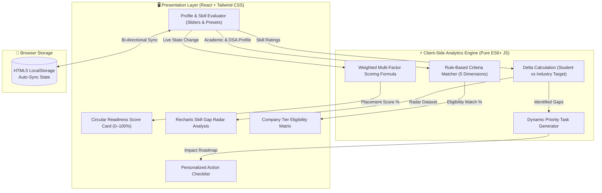

<div align="center">

# 🎓 CampusPulse
### AI-Inspired Student Placement Readiness & Skill-Gap Analytics Dashboard

[](https://reactjs.org/)
[](https://vitejs.dev/)
[](https://tailwindcss.com/)
[](https://recharts.org/)
[](https://opensource.org/licenses/MIT)
[](https://github.com/muskanji1007-lang/CampusPulse/pulls)

<p align="center">
  <b>Empowering engineering students to self-audit academic profiles, pinpoint skill deficiencies against industry benchmarks, and estimate placement likelihood with data-driven accuracy.</b>
</p>

[Explore Features](#-core-capabilities) • [System Flow](#-architecture--system-flow) • [Scoring Engine](#-algorithmic-scoring-matrix) • [Company Tiers](#-company-tier-eligibility-benchmarks) • [Quickstart](#-getting-started)

---

</div>

## 📌 Problem Statement

During campus recruitment seasons, thousands of engineering students apply blindly to tech companies without knowing:
- Whether their current **CGPA & Core CS fundamentals** qualify for shortlisting criteria.
- Where their **DSA & practical project proficiency** stands relative to industry cutoffs.
- Exactly **which specific topics** are bottlenecking their placement probability.

**CampusPulse** solves this problem by delivering a **zero-latency, client-side placement diagnostic suite** that calculates an algorithmic **Placement Readiness Index (0–100%)**, visualizes skill gaps using multi-axis radar charts, and generates personalized, actionable preparation roadmaps.

---

## 🏗️ Architecture & System Flow

CampusPulse implements an asynchronous, client-side reactive pipeline that decouples user input evaluation from persistent browser state:



---

## 📊 Algorithmic Scoring Matrix

The **Placement Readiness Index** calculates a composite score using industry-validated hiring weights:

$$\text{Readiness Index} = \sum (\text{Weight}_i \times \text{Factor}_i)$$

```text
Factor                     Weight     Contribution Bar                     Focus Area
────────────────────────────────────────────────────────────────────────────────────────────────────────
1. DSA & Problem Solving    30%       ████████████░░░░░░░░░░░░░░░░░░░░     Arrays, Trees, DP, Graphs
2. Academic Consistency     25%       ██████████░░░░░░░░░░░░░░░░░░░░░░     Cumulative College CGPA
3. Full-Stack / Projects    20%       ████████░░░░░░░░░░░░░░░░░░░░░░░░     Practical Dev & Deployment
4. Core CS Fundamentals     15%       ██████░░░░░░░░░░░░░░░░░░░░░░░░░░     OS, DBMS, CN, OOPS
5. Practical Experience     10%       ████░░░░░░░░░░░░░░░░░░░░░░░░░░░░     Internships & HR Soft Skills
────────────────────────────────────────────────────────────────────────────────────────────────────────
Total Score                100%       Dynamic Threshold (High >= 85%, Moderate >= 70%, Foundation < 55%)
```

---

## 🏢 Company Tier Eligibility Benchmarks

CampusPulse categorizes recruiters into three distinct recruitment tiers with strict eligibility parameters:

| Tier Category | Typical Recruiters | Est. CTC (LPA) | Min CGPA | Min DSA Rating | Min Projects | Technical Focus |
|:---|:---|:---:|:---:|:---:|:---:|:---|
| **Tier 1: Product Titans** | Google, Amazon, Microsoft, Uber, Atlassian | **18 – 45+** | `8.0` | `4.5 / 5.0` | `3+` | Advanced Trees, Graphs, DP, System Architecture |
| **Tier 2: Scale-Up Unicorns** | Razorpay, Cred, Zomato, BrowserStack, Postman | **9 – 18** | `7.0` | `3.5 / 5.0` | `2+` | Full-Stack Capabilities, REST APIs, System Design |
| **Tier 3: Enterprise IT** | TCS Digital/Ninja, Infosys DSE, Wipro, Accenture | **4 – 9** | `6.5` | `2.5 / 5.0` | `1+` | OOPS, Basic Data Structures, Quantitative Aptitude |

---

## ✨ Core Capabilities

<table>
  <tr>
    <td width="50%">
      <h3>🎯 Circular Placement Readiness Gauge</h3>
      <p>An animated SVG gauge that recalibrates in real-time as users adjust their academic or skill metrics. Displays granular contribution breakdowns per subject.</p>
    </td>
    <td width="50%">
      <h3>🕸️ Multi-Axis Skill Gap Radar Chart</h3>
      <p>Built with <code>Recharts</code> to visually compare individual student competencies against standardized industry expectations across 6 dimensions.</p>
    </td>
  </tr>
  <tr>
    <td width="50%">
      <h3>🏢 Live Company Tier Matrix</h3>
      <p>Instant evaluation showing whether the candidate qualifies for direct recruitment drives with color-coded checklists of missing criteria.</p>
    </td>
    <td width="50%">
      <h3>🗺️ Actionable Prep Roadmap</h3>
      <p>A prioritized, interactive checklist specifying target LeetCode modules and project goals, highlighting the estimated probability impact of each milestone.</p>
    </td>
  </tr>
</table>

---

## 🎨 Design System & Palette

CampusPulse avoids generic AI aesthetics in favor of a modern **Dark Navy & Vibrant Teal** palette designed for enterprise SaaS interfaces:

```text
Primary Background      :  #060B18  (Navy 950 - Deep Space)
Surface Card Panels     :  #0B132B  (Navy 900 - Subtle Glass Panel)
Borders & Dividers      :  #1C2541  (Navy 800 - Contrast Border)
Brand Accent / Glowing  :  #00B4D8  (Teal 500 - Active Focus)
Secondary Highlights    :  #48CAE4  (Teal 400 - Metric Glow)
Typography              :  Plus Jakarta Sans (Sans-serif) & JetBrains Mono (Code/Numbers)
```

---

## 📁 Repository Structure

```text
CampusPulse/
├── src/
│   ├── components/                 # Reusable UI Architecture
│   │   ├── Navbar.jsx              # Header with logo, verified status & GitHub link
│   │   ├── Sidebar.jsx             # Category switching & live readiness summary
│   │   ├── StudentProfileForm.jsx  # Sliders, presets (Entry, Moderate, Top Performer)
│   │   ├── ReadinessScoreCard.jsx  # SVG circular progress gauge & points breakdown
│   │   ├── SkillRadarChart.jsx     # Recharts multi-axis radar chart with gap pills
│   │   ├── CompanyEligibilityTable.jsx # Tier 1/2/3 eligibility breakdown & CTC info
│   │   └── ActionableRoadmap.jsx   # Priority checklist with placement likelihood impact
│   │
│   ├── data/
│   │   └── companyBenchmarks.js    # Standard recruitment cutoffs & student initial state
│   │
│   ├── utils/
│   │   ├── analyticsEngine.js      # Weighted scoring, tier matching & gap math
│   │   └── storage.js              # HTML5 LocalStorage persistence handlers
│   │
│   ├── App.jsx                     # Master state controller & confetti celebration
│   ├── index.css                   # Tailwind layers, radial glow, custom scrollbars
│   └── main.jsx                    # Vite React client entry point
│
├── index.html                      # Single Page Application HTML root
├── tailwind.config.js              # Custom theme tokens & glow shadows
├── vite.config.js                  # Fast HMR build setup
├── package.json                    # Project manifest & dependencies
└── .gitignore                      # Excluded artifacts (node_modules, dist)
```

---

## 🚀 Getting Started

### Prerequisites
- [Node.js](https://nodejs.org/) (v18.0.0 or higher recommended)
- `npm` (bundled with Node.js)

### Installation & Run

1. **Clone the repository:**
   ```bash
   git clone https://github.com/muskanji1007-lang/CampusPulse.git
   cd CampusPulse
   ```

2. **Install project dependencies:**
   ```bash
   npm install
   ```

3. **Start local development server:**
   ```bash
   npm run dev
   ```

4. Open your browser at **`http://localhost:5173`** to test the live application!

5. **Build for Production:**
   ```bash
   npm run build
   ```

---

## 👩‍💻 Author

Crafted with dedication by **[Muskan Gupta](https://github.com/muskanji1007-lang)**  
*Aspiring Frontend Software Engineer & React Enthusiast*

---

<div align="center">
  <sub>⭐ If you find CampusPulse insightful, please consider starring this repository!</sub>
</div>
